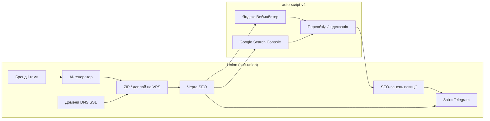
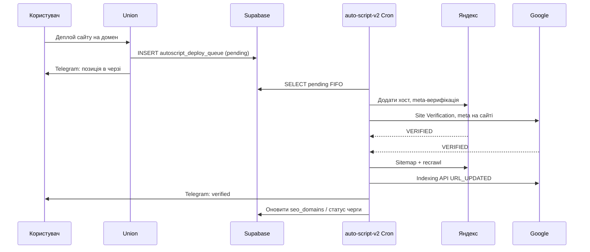

# Union — платформа генерації та SEO для affiliate-сайтів

**Union** (soft-union) — єдина веб-платформа для команд, які масштабують створення нішевих сайтів: від AI-генерації контенту та бренду до реєстрації домену, деплою на VPS, моніторингу позицій і автоматичної індексації в Яндекс та Google.

Інтерфейс українською, англійською та російською. Кожен користувач працює в ізольованому акаунті з власними ключами API, доменами та налаштуваннями.

---

## Для чого потрібна Union

Традиційний процес «сайт під ключ» розтягується на дні: бриф → копірайт → верстка → домен → DNS → SSL → деплой → Вебмайстер → Search Console → очікування індексації. Union зводить це до **одного кабінету** і **повторюваного пайплайну**, який можна запускати десятками проєктів паралельно.

Платформа орієнтована на:

- **Affiliate / SEO-команди** — швидкий запуск мультисторінкових лендінгів під гео та семантику.
- **Адміністраторів мережі** — керування користувачами, брендами, аналітикою токенів і глобальною чергою SEO.
- **Операторів**, які хочуть мінімізувати ручну роботу з DNS, SSL, деплоєм і пошуковими системами.

---

## Як працює платформа



### Типовий сценарій користувача

1. **Налаштування** — у Settings зберігаються персональні ключі: Claude, Spaceship, Zomro, SSL, SSH-хост, Yandex XML Stock, Telegram, credentials для auto-script.
2. **Бренд** — назва, логотип, favicon, палітра, гео-таргетинг, SEO-ключові слова та пресети тем (користувач редагує сам; адмін — через Users → Brand).
3. **Генерація** — AI (Claude) будує мультисторінковий React-сайт: унікальні layout-варіанти, архітектура сторінок, контент під тему. Ключові слова розподіляються по сторінках; для кожного маршруту генеруються окремі title, description, canonical.
4. **Домен** — пошук і реєстрація через Spaceship, DNS у Zomro, випуск Let's Encrypt, nginx на VPS.
5. **Деплой** — готовий сайт завантажується в папку домену на хості; після успіху домен потрапляє в **спільну чергу SEO**.
6. **SEO-моніторинг** — ключові слова, перевірка позицій у Яндекс, експорт CSV, звіти в Telegram.
7. **Облік** — модуль Usage показує витрати токенів Claude по кожній генерації; адмін бачить глобальну аналітику в Generator Analytics.

---

## Детальний опис можливостей

### Налаштування бренду (`/dashboard/brand` для користувача; Users → Brand для адміна)

Редактор бренду зберігає єдиний **brand kit**, який підтягується в кожну генерацію:

| Поле | Призначення |
|------|-------------|
| **Назва бренду** | Відображається в UI сайту, заголовках, промптах Claude |
| **Гео цільової аудиторії** | Регіон для SEO-контенту (див. нижче) |
| **Тема за замовчуванням** | Базова семантика, якщо клієнт не обрав пресет |
| **Додаткові інструкції для Claude** | Prompt overlay — тон, заборони, акценти для всіх генерацій |
| **Айдентика layout** | `auto` (чергування sidebar / top-nav), `sidebar` або `top-nav` |
| **Палітра (3 кольори)** | Акцент, фон, текст; похідні відтінки підставляються автоматично |
| **Логотип / Favicon** | Завантаження в Supabase Storage, підстановка в збірку |
| **Зображення** | Банери (hero), слоти (ігри), оплати (Visa/Mastercard тощо), інше |
| **Пресети тем** | Назва, текст теми, SEO-ключі, кількість сторінок (3 або 4, або «як у формі») |
| **Нотатки** | Лише для адміна — внутрішні коментарі до акаунта |

Користувач редагує свій бренд самостійно. Адміністратор **не бачить** окремий пункт «Бренд» у хедері — керує брендами через **Users → Brand**.

### Гео-таргетинг

У бренді доступний **GeoRegionPicker** — вибір цільового регіону з прапором і пошуком. Підтримувані регіони (20):

🇷🇺 Росія · 🇺🇦 Україна · 🇰🇿 Казахстан · 🇧🇾 Білорусь · 🇺🇿 Узбекистан · 🇦🇿 Азербайджан · 🇬🇪 Грузія · 🇦🇲 Вірменія · 🇲🇩 Молдова · 🇰🇬 Киргизстан · 🇹🇯 Таджикистан · 🇹🇲 Туркменістан · 🇩🇪 Німеччина · 🇵🇱 Польща · 🇹🇷 Туреччина · 🇮🇳 Індія · 🇧🇷 Бразилія · 🇲🇽 Мексика · 🇨🇦 Канада · 🇦🇺 Австралія

Обране гео потрапляє в SEO-промпти Claude (мова, локаль, контекст «для якої країни» пишеться сторінка). Це впливає на формулювання title/description і тексту в `<main>`.

### Пресети тем і ключові слова

- **Пресет теми** — готова семантика для генератора: назва, текст теми, опційно фіксована кількість сторінок (3 або 4).
- У генераторі клієнт обирає пресет з випадаючого списку або вводить тему вручну.
- **SEO-ключові слова теми** — до 48 фраз (через кому або з нового рядка). Застосовуються, коли обрано цей пресет.
- **Розподіл ключів по сторінках** — round-robin: наприклад, 30 ключів на 3 сторінки ≈ 10 на кожну. AI може перефразувати фрази під контекст конкретної URL.
- Для кожної сторінки генеруються унікальні **title**, **description**, **meta keywords** і **canonical URL**.

### Генератор сайтів — параметри запуску

| Параметр | Значення |
|----------|----------|
| **Slug проєкту** | Ім’я папки/ZIP (напр. `u-casino742`), можна згенерувати випадково |
| **Тема / пресет** | З бренду або ручний ввід |
| **Сторінок у пакеті** | **1–4** (головна + внутрішні маршрути) |
| **Сайтів за раз** | **1–10** паралельних jobs у одному батчі |
| **Режим генерації** | `standard` або `bot_gate` (див. нижче) |
| **Хост деплою** | Опційно — VPS з вільною папкою під домен |
| **Base URL** | Домен для canonical, sitemap, robots |

Збірка **асинхронна** (background job): статус у реальному часі, скасування, завантаження ZIP, деплой на хост одним кліком.

### Два режими генерації сайту

| Режим | UI-назва | Поведінка |
|-------|----------|-----------|
| **`standard`** | **Усі** | Згенерований сайт відкривається для всіх відвідувачів. SPA через `index.html` + `.htaccess` rewrite. |
| **`bot_gate`** | **Лише боти** | Yandex і Google індексують повну SEO-сторінку; **звичайні користувачі** перенаправляються на gateway бренду. Точка входу — `index.php` з PHP-gate перед SPA-оболонкою. |

Режим зберігається в маніфесті `.aurora_multipage.json` і враховується при деплої (nginx/vhost, htaccess).

### Скільки сторінок генерується

- **Мінімум:** 1 (лише головна `/`)
- **Максимум:** **4** (головна + до 3 внутрішніх маршрутів)
- Slug внутрішніх сторінок обираються детерміновано з пулу (`bonus`, `mirror`, `app`, `login`, `registration`, `faq-page`, `policy` тощо) — унікально для кожного проєкту.
- Якщо в пресеті теми задано `pageCount: 3` або `4` — генератор підставляє це значення автоматично при виборі теми.
- Якщо кількість не задана явно — випадково від 1 до 4 (за seed проєкту).

### Що містить згенерований сайт (React Lab, production)

На хост деплояться **лише production-файли** (вихідний React-код у `_react_src/` залишається на воркері, не на VPS):

```
/
├── index.html              # головна з унікальним <title>, description, keywords, canonical, og:*
├── bonus/index.html        # (та інші маршрути) — окремий SEO-head на кожен URL
├── assets/                 # JS/CSS бандл Vite (хешовані імена)
├── img/                    # логотип, favicon, банери, слоти, оплати з brand kit
├── robots.txt              # User-agent: * / Allow / / Sitemap
├── sitemap.xml             # усі URL сайту з пріоритетами
├── config.php              # gateway URL бренду (захищений від прямого доступу)
├── .htaccess               # SPA rewrite; у bot_gate — fallback на index.php
├── index.php               # лише в режимі bot_gate (PHP gate)
└── .aurora_multipage.json  # маніфест: stack, routes, generationMode, brand, pages
```

**SEO на кожній сторінці:** `<title>`, `<meta name="description">`, `<meta name="keywords">`, `<link rel="canonical">`, Open Graph (`og:title`, `og:description`).

**Якість контенту:** мінімум/максимум слів у `<main>` (налаштовується через `SOFTGEN_MIN_PAGE_WORDS`, `SOFTGEN_MAX_PAGE_WORDS`), згадки бренду в заголовках і абзацах, автоматичний реген при надто короткому тексті або високій схожості між сторінками.

### Аналітика токенів і історія генерацій

#### Usage (`/dashboard/usage`) — для кожного користувача

- **Зрізи витрат:** сьогодні, тиждень, місяць, весь час.
- **Середній розхід** на одну успішну генерацію.
- **Історія jobs** (по 30 на сторінку): slug проєкту, статус (`done` / `error` / `cancelled` / `dry_run`), input/output/total tokens, шаблон chrome, дата.
- **Пошук** за slug, моделлю або фрагментом job id.
- **Фільтр за статусом** — швидко знайти помилки або тестові dry-run.

#### Generator Analytics (`/dashboard/generator-analytics`) — лише для адміна

- **Глобальні токени** по всіх акаунтах: today / week / month / all-time.
- **Кількість генерацій**, унікальних користувачів, загальна кількість jobs.
- **Історія з email користувача**, skeleton fingerprint, layout, pageCount.
- **Подібність структур** між сайтами (`maxSimilarityPercent`, пари схожих проєктів) — контроль унікальності каркасів.
- Пошук і фільтри як у Usage, але з огляду на всю мережу.

Обидва модулі пишуть дані з таблиць обліку генерацій у Supabase після завершення кожного build job.

---

## Модулі та особливості

### Генератор сайтів

- **React Lab** — SPA-сайти на Vite + React, готові до Apache/nginx.
- **Мультисторінковість** — від **1 до 4** сторінок з окремою семантикою та canonical на кожну.
- **Батч** — до **10 сайтів** за один запуск.
- **Два режими** — `standard` (усім) і `bot_gate` (індексація для ботів, редирект людей на gateway).
- **Унікальні каркаси** — layout-варіанти L01–L22, порядок секцій від seed проєкту, не копія чужого HTML.
- **Фонові jobs** — асинхронна збірка; cancel, ZIP, деплой на хост.
- **Якість** — ліміти слів, реген при короткому/схожому тексті, контроль згадок бренду.

### Бренд і гео

- **Brand kit** — назва, нотатки, prompt overlay, layout variant, палітра.
- **Гео** — 20 регіонів, пошук, прапори; вплив на SEO-промпти.
- **Пресети тем** — готова семантика + ключі + опційно pageCount.
- **Round-robin ключів** — розподіл SEO-фраз по сторінках при збірці.
- **Медіа** — logo, favicon, банери, слоти, оплати в Storage.
- **Ролі** — user: `/dashboard/brand`; admin: Users → Brand (без окремого пункту в хедері).

### Домени та інфраструктура

- Реєстрація домену (**Spaceship**), DNS (**Zomro**), **Let's Encrypt SSL**.
- Автоматичний **nginx vhost** і деплой у `SUBDOMAIN_HOST_PROJECTS_DIR`.
- Прив’язка **хостів** (VPS) до акаунта; вибір вільної папки під домен.
- Telegram-сповіщення на ключових етапах (реєстрація, SSL, деплой, помилки).

### SEO-панель

- Додавання доменів, імпорт і керування **ключовими словами**.
- Перевірка **позицій у Яндекс** через XML Stock API.
- **CSV-експорт** для звітності.
- Ізоляція даних по `user_id` — користувачі не бачать чужі домени.

### Облік AI-токенів (Usage)

- Зрізи: день / тиждень / місяць / весь час + середній розхід на генерацію.
- Повна **історія jobs** з токенами (input, output, total), статусом, датою, chrome template.
- Пошук, фільтр за статусом, пагінація по 30 записів.

### Адмін-панель

- **Users** — профілі, ролі, freeze акаунтів, порядкові номери, перехід до Brand.
- **Generator Analytics** — глобальні токени по мережі, історія всіх генерацій, skeleton fingerprint, **подібність структур** між проєктами та акаунтами.
- **Brand per user** — повний редактор бренду для будь-якого користувача.

### Telegram-інтеграція

- Підключення бота до акаунта (код лінкування в Settings).
- Сповіщення **uk / en / ru** залежно від мови користувача.
- Події: черга SEO, верифікація Яндекс/Google, деплой, помилки генерації.

### Settings — персональний .env

Кожен акаунт зберігає свої інтеграції в БД (`account_integration_settings`): Claude, Spaceship, Zomro, SSL, хост, Yandex SEO, Telegram, webhook auto-script. Секрети не показуються повторно після збереження.

---

## Результати, які приносить Union

| Напрям | Без Union | З Union |
|--------|-----------|---------|
| Час до live-сайту | Дні (ручні кроки) | Години (автоматизований ланцюжок) |
| Масштаб | 1–2 сайти на тиждень | Десятки паралельних генерацій |
| SEO-онбординг | Ручна верифікація в 2 ПС | Черга + worker після кожного деплою |
| Контроль витрат | Розрізнені логи API | Єдиний Usage по всіх jobs |
| Бренд-консистентність | Розкидані файли/нотатки | Централізований brand kit + теми |
| Звітність | Таблиці вручну | Позиції, CSV, Telegram |

**Бізнес-ефект:** швидший time-to-market для нових гео/ніш, передбачувана собівартість генерації (токени), менше операційних помилок на DNS/SSL/деплої, швидший старт індексації після публікації.

---

## auto-script-v2 — роль у екосистемі

**auto-script-v2** — окремий Python worker ([Stavoker/union-auto-script](https://github.com/Stavoker/union-auto-script)). Він **не входить** у репозиторій soft-union і деплоїться окремо (зазвичай Render Cron Job).

### Розподіл відповідальності

| Задача | Union (soft-union) | auto-script-v2 |
|--------|-------------------|----------------|
| Генерація сайту | ✅ | — |
| Купівля домену, DNS, SSL | ✅ | — |
| Деплой на VPS (SFTP/SSH) | ✅ | — |
| Додавання сайту в Яндекс Вебмайстер | — | ✅ |
| Додавання в Google Search Console | — | ✅ |
| HTML/meta-верифікація на сайті | — | ✅ (через SFTP) |
| Sitemap + переобхід (Яндекс) | — | ✅ |
| Google Indexing API | — | ✅ |
| Черга після деплою | ✅ (запис у Supabase) | ✅ (обробка FIFO) |
| Telegram про статус SEO | ✅ (постановка в чергу) | ✅ (verified / pending) |

Union займається **продуктом і інфраструктурою**; auto-script-v2 — **пошукові системи після того, як сайт уже на хості з валідним SSL**.

### Як працює інтеграція



1. Після успішного деплою Union викликає `enqueueAutoscriptDeploy()` — запис у таблицю `autoscript_deploy_queue` (домен, SSH-шлях, user_id, host).
2. Користувач отримує Telegram `seo_verify_queued` з позицією в глобальній черзі (видно також у Settings).
3. Cron worker (`DISCOVERY_MODE=queue`) забирає завдання **FIFO**, підключається по SSH/SFTP до того ж хоста.
4. **Яндекс:** додає `https://domain/`, виставляє verification meta/HTML, після `VERIFIED` — sitemap і API переобходу.
5. **Google:** Site Verification + Search Console, після підтвердження — Indexing API для головної та URL з sitemap.
6. Credentials (Yandex OAuth, Google Service Account) беруться з **налаштувань користувача** в Union — у кожного акаунта свої ключі.
7. Опційно: HTTP webhook (`AUTOSCRIPT_WEBHOOK_URL`) для миттєвого запуску поряд із cron-полінгом.

### Чому окремий сервіс

- **Надійність** — довгі цикли верифікації (чекання DNS, повторні перевірки) не блокують веб-додаток Union.
- **Масштаб** — одна глобальна черга на всіх користувачів; worker обробляє послідовно з контролем квот API.
- **Безпека** — service role Supabase і SSH лише на worker; Union лише ставить завдання в чергу.

---

## Технічний стек

| Шар | Технології |
|-----|------------|
| Frontend | Next.js 16, React 19, TypeScript, Tailwind CSS v4, Framer Motion |
| i18n | next-intl (uk, en, ru) |
| Backend / API | Next.js App Router, Route Handlers |
| База | Supabase (Auth, Postgres, RLS, Storage) |
| AI | Anthropic Claude API |
| Worker SEO | Python 3, auto-script-v2 (окремий репозиторій) |
| Деплой Union | Render Web Service |

---

## Локальний запуск

```bash
npm install
cp .env.example .env.local
npm run dev
```

Відкрийте [http://localhost:3000/uk](http://localhost:3000/uk) (локалі: `uk`, `en`, `ru`).

Міграції Supabase — у `supabase/migrations/`. Для SEO-черги потрібні як мінімум:

- `20260618120000_autoscript_deploy_queue.sql`
- `20260619130000_generator_brand_geo_user_edit.sql`

## Деплой на Render

- **Build:** `npm run build`
- **Start:** `npm run start`
- Секрети — з `.env.example` у dashboard Render; Redis і Supabase service keys лише на сервері.

## Структура репозиторію

```
src/
  app/              App Router, [locale], dashboard, API routes
  i18n/             routing, navigation
  lib/              generator-engine, brand, admin-seo, telegram
  shared/           UI, config, Supabase clients
messages/           uk.json, en.json, ru.json
supabase/migrations SQL-схема та RLS
```

## Репозиторії екосистеми

| Проєкт | GitHub | Призначення |
|--------|--------|-------------|
| **Union** | [Stavoker/union-software](https://github.com/Stavoker/union-software) | Веб-платформа (цей репозиторій) |
| **auto-script-v2** | [Stavoker/union-auto-script](https://github.com/Stavoker/union-auto-script) | Cron worker: Яндекс + Google після деплою |

---

## Ліцензія

Приватний проєкт.
