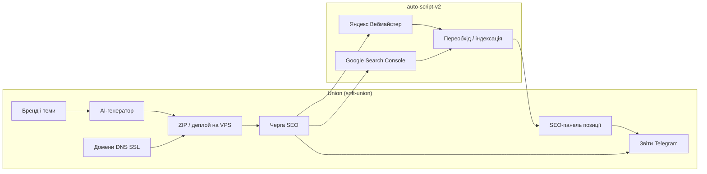
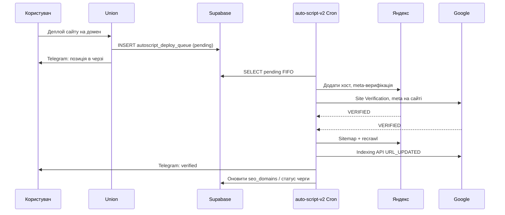

# Union — платформа генерації та SEO для affiliate-сайтів

**Union** (soft-union) — єдина веб-платформа для команд, які масштабують створення нішевих сайтів: від AI-генерації контенту та бренду до реєстрації домену, деплою на VPS, моніторингу позицій і автоматичної індексації в Яндекс та Google.

Інтерфейс українською, англійською та російською. Кожен користувач працює в ізольованому акаунті з власними ключами API, доменами та налаштуваннями.

---

## Для чого потрібна Union

Традиційний процес «сайт під ключ» розтягується на дні: бриф → копірайт → верстка → домен → DNS → SSL → деплой → Вебмайстер → Search Console → очікування індексації. Union зводить це до **одного кабінету** і **повторюваного пайплайну**, який можна запускати десятками проєктів паралельно.

Платформа орієнтована на:

- **Affiliate / SEO-команди** — швидкий запуск мультисторінкових лендінгів під гео та семантику.
- **Адміністраторів мережі** — керування користувачами, брендами, аналітикою токенів і глобальною чергою SEO.
- **Операторів**, які хочуть мінімізувати ручну роботу з DNS, SSL, деплоєм і пошуковими системами.

---

## Як працює платформа



### Типовий сценарій користувача

1. **Налаштування** — у Settings зберігаються персональні ключі: Claude, Spaceship, Zomro, SSL, SSH-хост, Yandex XML Stock, Telegram, credentials для auto-script.
2. **Бренд** — назва, логотип, favicon, палітра, гео-таргетинг, SEO-ключові слова та пресети тем (користувач редагує сам; адмін — через Users → Brand).
3. **Генерація** — AI (Claude) будує мультисторінковий React-сайт: унікальні layout-варіанти, архітектура сторінок, контент під тему. Ключові слова розподіляються по сторінках; для кожного маршруту генеруються окремі title, description, canonical.
4. **Домен** — пошук і реєстрація через Spaceship, DNS у Zomro, випуск Let's Encrypt, nginx на VPS.
5. **Деплой** — готовий сайт завантажується в папку домену на хості; після успіху домен потрапляє в **спільну чергу SEO**.
6. **SEO-моніторинг** — ключові слова, перевірка позицій у Яндекс, експорт CSV, звіти в Telegram.
7. **Облік** — модуль Usage показує витрати токенів Claude по кожній генерації.

---

## Модулі та особливості

### Генератор сайтів

- **React Lab** — сучасні SPA-сайти (Vite), готові до продакшену.
- **Мультисторінковість** — 3–5+ сторінок з окремою семантикою на кожну.
- **Режими генерації** — стандартний і Bot Gate для специфічних сценаріїв трафіку.
- **Без жорсткого референса** — унікальні каркаси (layout L01–L22), а не копія чужого HTML.
- **Фонові jobs** — збірка асинхронна; можна скасувати, завантажити ZIP, задеплоїти на прив’язаний хост.
- **Якість контенту** — регульовані ліміти слів, температура моделі, опційний реген при короткому тексті.

### Бренд і гео

- Єдиний **brand kit**: назва, нотатки, overlay для промптів, варіант layout, палітра кольорів.
- **Гео-таргетинг** — вибір регіону з прапорами та пошуком; враховується при генерації.
- **SEO-ключі на рівні тем** — round-robin розподіл по сторінках під час збірки.
- **Медіа** — логотип, favicon, додаткові зображення в Supabase Storage.
- **Розділення ролей** — користувач бачить `/dashboard/brand`; адмін керує брендом будь-якого акаунта через Users.

### Домени та інфраструктура

- Реєстрація домену (**Spaceship**), DNS (**Zomro**), **Let's Encrypt SSL**.
- Автоматичний **nginx vhost** і деплой у `SUBDOMAIN_HOST_PROJECTS_DIR`.
- Прив’язка **хостів** (VPS) до акаунта; вибір вільної папки під домен.
- Telegram-сповіщення на ключових етапах (реєстрація, SSL, деплой, помилки).

### SEO-панель

- Додавання доменів, імпорт і керування **ключовими словами**.
- Перевірка **позицій у Яндекс** через XML Stock API.
- **CSV-експорт** для звітності.
- Ізоляція даних по `user_id` — користувачі не бачать чужі домени.

### Облік AI-токенів (Usage)

- Історія генерацій: модель, токени, вартість, статус job.
- Фільтри, пошук, пагінація — контроль витрат при масових запусках.

### Адмін-панель

- **Users** — профілі, ролі, freeze акаунтів, порядкові номери.
- **Generator Analytics** — глобальна аналітика токенів, подібність структур сайтів між акаунтами.
- **Brand per user** — повний редактор бренду для будь-якого користувача.

### Telegram-інтеграція

- Підключення бота до акаунта (код лінкування в Settings).
- Сповіщення **uk / en / ru** залежно від мови користувача.
- Події: черга SEO, верифікація Яндекс/Google, деплой, помилки генерації.

### Settings — персональний .env

Кожен акаунт зберігає свої інтеграції в БД (`account_integration_settings`): Claude, Spaceship, Zomro, SSL, хост, Yandex SEO, Telegram, webhook auto-script. Секрети не показуються повторно після збереження.

---

## Результати, які приносить Union

| Напрям | Без Union | З Union |
|--------|-----------|---------|
| Час до live-сайту | Дні (ручні кроки) | Години (автоматизований ланцюжок) |
| Масштаб | 1–2 сайти на тиждень | Десятки паралельних генерацій |
| SEO-онбординг | Ручна верифікація в 2 ПС | Черга + worker після кожного деплою |
| Контроль витрат | Розрізнені логи API | Єдиний Usage по всіх jobs |
| Бренд-консистентність | Розкидані файли/нотатки | Централізований brand kit + теми |
| Звітність | Таблиці вручну | Позиції, CSV, Telegram |

**Бізнес-ефект:** швидший time-to-market для нових гео/ніш, передбачувана собівартість генерації (токени), менше операційних помилок на DNS/SSL/деплої, швидший старт індексації після публікації.

---

## auto-script-v2 — роль у екосистемі

**auto-script-v2** — окремий Python worker ([Stavoker/union-auto-script](https://github.com/Stavoker/union-auto-script)). Він **не входить** у репозиторій soft-union і деплоїться окремо (зазвичай Render Cron Job).

### Розподіл відповідальності

| Задача | Union (soft-union) | auto-script-v2 |
|--------|-------------------|----------------|
| Генерація сайту | ✅ | — |
| Купівля домену, DNS, SSL | ✅ | — |
| Деплой на VPS (SFTP/SSH) | ✅ | — |
| Додавання сайту в Яндекс Вебмайстер | — | ✅ |
| Додавання в Google Search Console | — | ✅ |
| HTML/meta-верифікація на сайті | — | ✅ (через SFTP) |
| Sitemap + переобхід (Яндекс) | — | ✅ |
| Google Indexing API | — | ✅ |
| Черга після деплою | ✅ (запис у Supabase) | ✅ (обробка FIFO) |
| Telegram про статус SEO | ✅ (постановка в чергу) | ✅ (verified / pending) |

Union займається **продуктом і інфраструктурою**; auto-script-v2 — **пошукові системи після того, як сайт уже на хості з валідним SSL**.

### Як працює інтеграція



1. Після успішного деплою Union викликає `enqueueAutoscriptDeploy()` — запис у таблицю `autoscript_deploy_queue` (домен, SSH-шлях, user_id, host).
2. Користувач отримує Telegram `seo_verify_queued` з позицією в глобальній черзі (видно також у Settings).
3. Cron worker (`DISCOVERY_MODE=queue`) забирає завдання **FIFO**, підключається по SSH/SFTP до того ж хоста.
4. **Яндекс:** додає `https://domain/`, виставляє verification meta/HTML, після `VERIFIED` — sitemap і API переобходу.
5. **Google:** Site Verification + Search Console, після підтвердження — Indexing API для головної та URL з sitemap.
6. Credentials (Yandex OAuth, Google Service Account) беруться з **налаштувань користувача** в Union — у кожного акаунта свої ключі.
7. Опційно: HTTP webhook (`AUTOSCRIPT_WEBHOOK_URL`) для миттєвого запуску поряд із cron-полінгом.

### Чому окремий сервіс

- **Надійність** — довгі цикли верифікації (чекання DNS, повторні перевірки) не блокують веб-додаток Union.
- **Масштаб** — одна глобальна черга на всіх користувачів; worker обробляє послідовно з контролем квот API.
- **Безпека** — service role Supabase і SSH лише на worker; Union лише ставить завдання в чергу.

---

## Технічний стек

| Шар | Технології |
|-----|------------|
| Frontend | Next.js 16, React 19, TypeScript, Tailwind CSS v4, Framer Motion |
| i18n | next-intl (uk, en, ru) |
| Backend / API | Next.js App Router, Route Handlers |
| База | Supabase (Auth, Postgres, RLS, Storage) |
| AI | Anthropic Claude API |
| Worker SEO | Python 3, auto-script-v2 (окремий репозиторій) |
| Деплой Union | Render Web Service |

---

## Локальний запуск

```bash
npm install
cp .env.example .env.local
npm run dev
```

Відкрийте [http://localhost:3000/uk](http://localhost:3000/uk) (локалі: `uk`, `en`, `ru`).

Міграції Supabase — у `supabase/migrations/`. Для SEO-черги потрібні як мінімум:

- `20260618120000_autoscript_deploy_queue.sql`
- `20260619130000_generator_brand_geo_user_edit.sql`

## Деплой на Render

- **Build:** `npm run build`
- **Start:** `npm run start`
- Секрети — з `.env.example` у dashboard Render; Redis і Supabase service keys лише на сервері.

## Структура репозиторію

```
src/
  app/              App Router, [locale], dashboard, API routes
  i18n/             routing, navigation
  lib/              generator-engine, brand, admin-seo, telegram
  shared/           UI, config, Supabase clients
messages/           uk.json, en.json, ru.json
supabase/migrations SQL-схема та RLS
```

## Репозиторії екосистеми

| Проєкт | GitHub | Призначення |
|--------|--------|-------------|
| **Union** | [Stavoker/union-software](https://github.com/Stavoker/union-software) | Веб-платформа (цей репозиторій) |
| **auto-script-v2** | [Stavoker/union-auto-script](https://github.com/Stavoker/union-auto-script) | Cron worker: Яндекс + Google після деплою |

---

## Ліцензія

Приватний проєкт.
